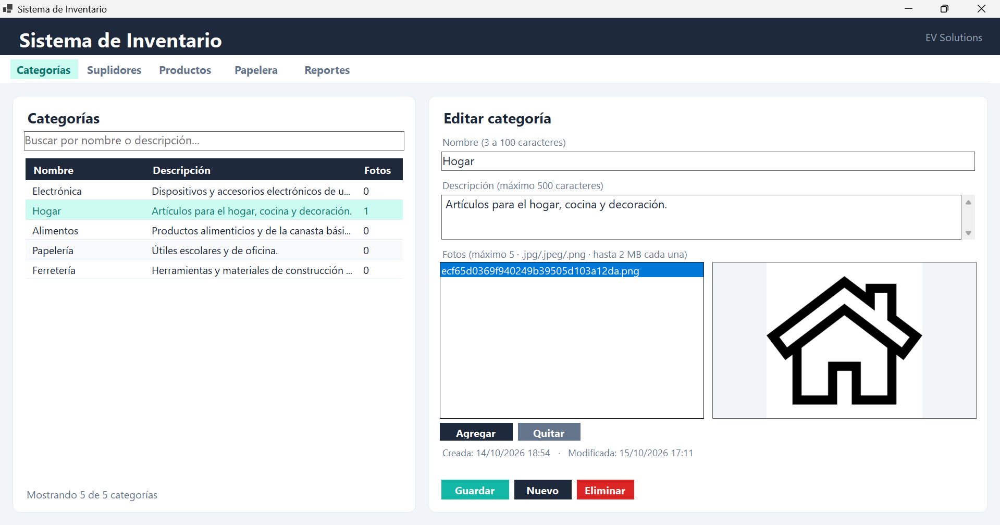
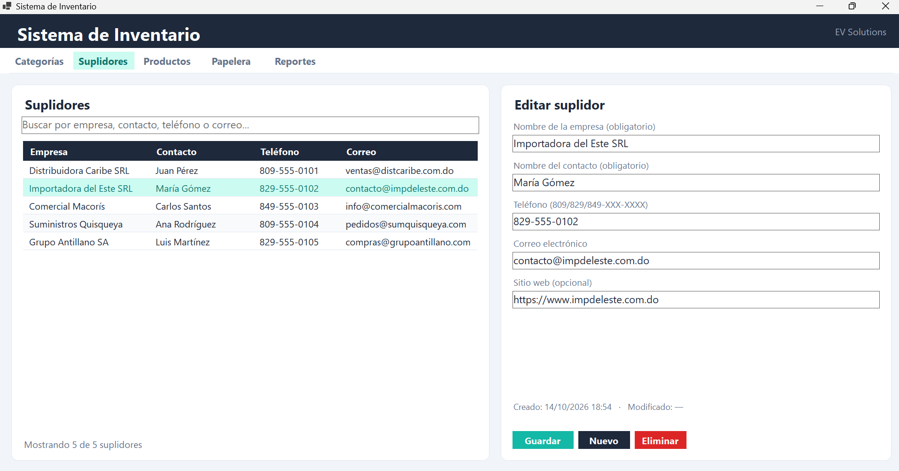
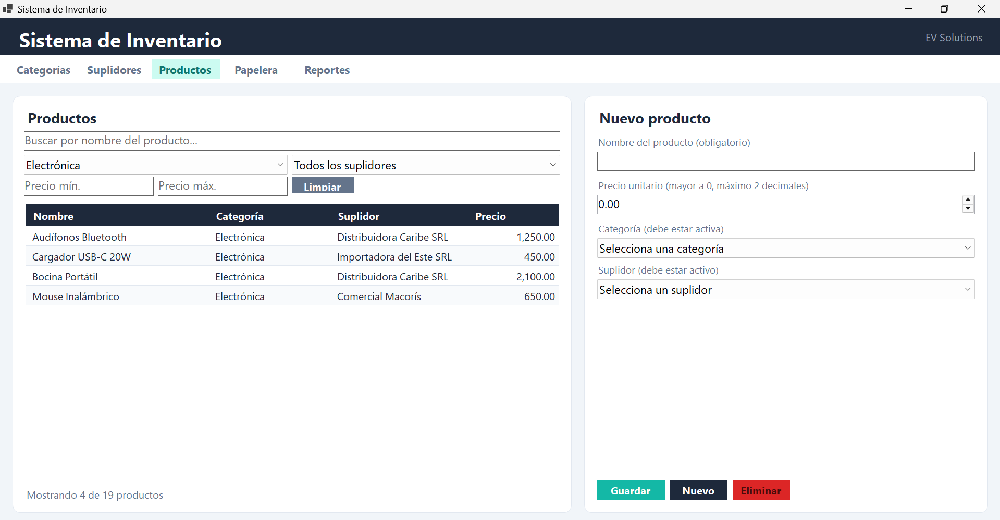
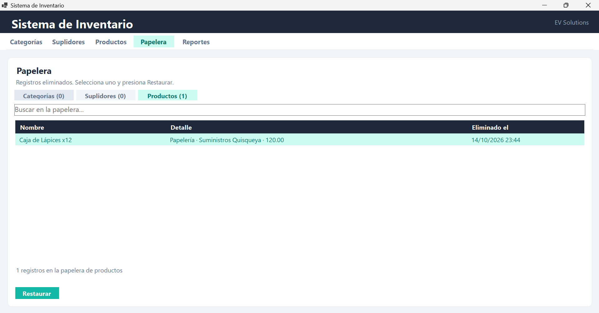
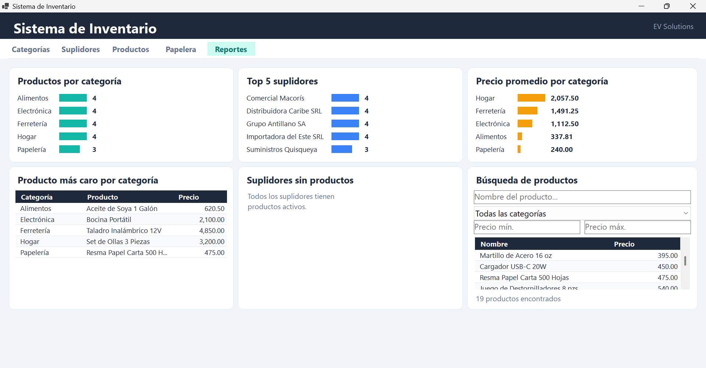
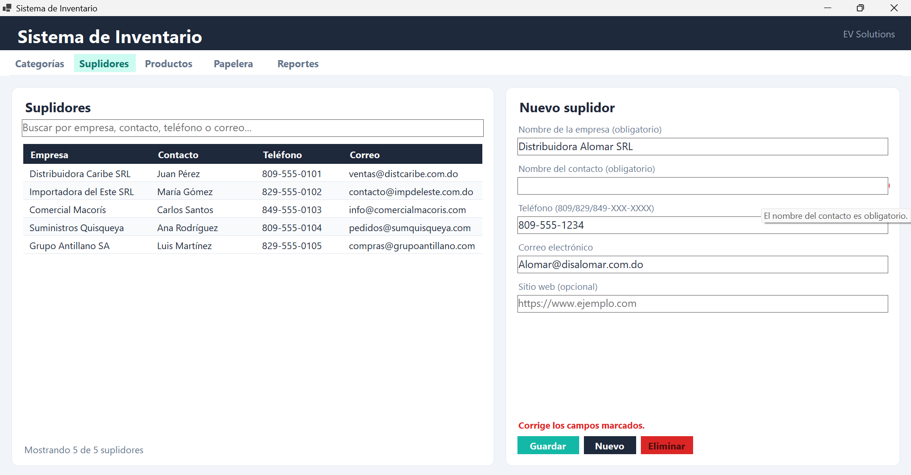
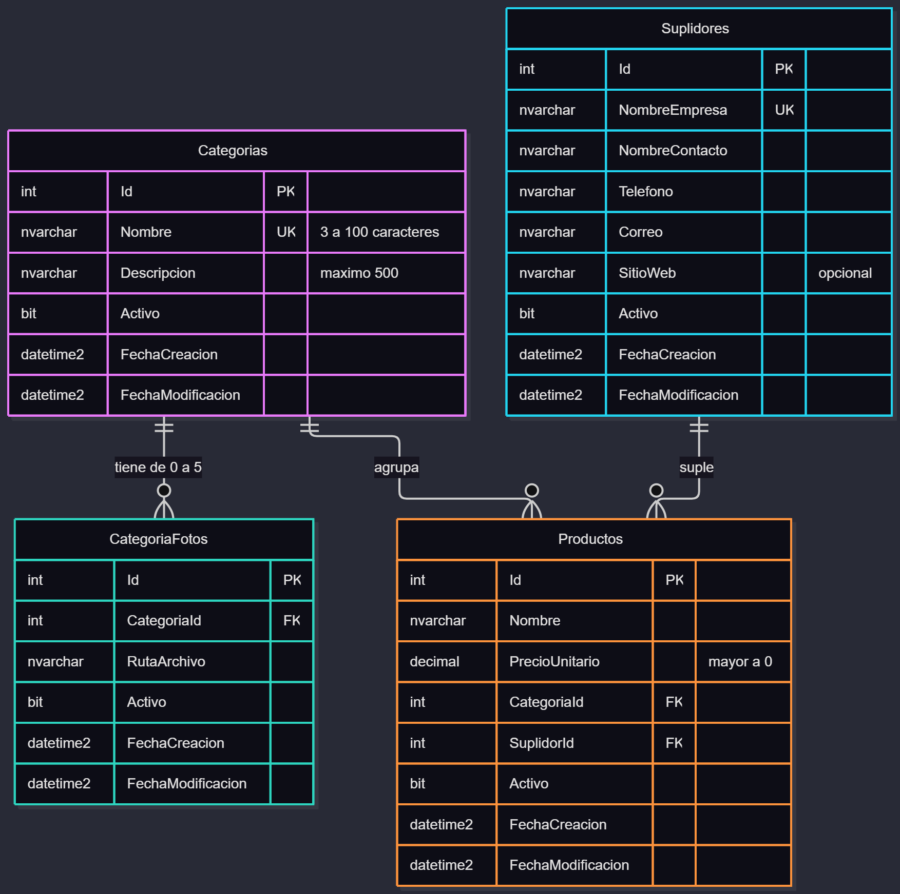

# Sistema de Gestión de Categorías, Suplidores y Productos

**Proyecto 1 · ISW-124 Programación Avanzada** · Universidad Central del Este
**Autor:** Emanuel Valdez · **EV Solutions**

Aplicación de escritorio en **C# / Windows Forms / SQL Server** para gestionar categorías (con fotos), suplidores y productos, con borrado lógico, papelera, búsqueda en tiempo real y reportes.

Está construida con **arquitectura por capas**, **Repository Pattern genérico**, **Singleton**, **inyección de dependencias por constructor**, **genéricos** y **LINQ**.

---

## Capturas de pantalla

| Categorías | Suplidores |
|---|---|
|  |  |

| Productos (filtros por categoría, suplidor y precio) | Papelera |
|---|---|
|  |  |

| Reportes (consultas LINQ) | Validaciones con ErrorProvider |
|---|---|
|  |  |

---

## Requisitos

| Para | Necesitas |
|---|---|
| Ejecutar el programa compilado (`/build`) | Windows 10/11 x64, [.NET 10 Desktop Runtime](https://dotnet.microsoft.com/download) y SQL Server (Express sirve) |
| Compilar el código fuente | Visual Studio con la carga de trabajo **Desarrollo de escritorio con .NET** |
| Administrar la base de datos | SQL Server Management Studio (SSMS) |

---

## Instalación

### 1. Crear la base de datos

1. Abre **SSMS** y conéctate a tu servidor (por ejemplo `.\SQLEXPRESS`).
2. Abre `database/schema.sql` y presiona **F5**. Crea la base `SistemaInventario` y sus 4 tablas.
3. Abre `database/datos.sql` y presiona **F5**. Carga 5 categorías, 5 suplidores y 20 productos de prueba.

> Ejecuta `datos.sql` **una sola vez**: los nombres de categorías y suplidores son únicos.

### 2. Configurar la conexión

La cadena de conexión vive en un archivo `appsettings.json` que **no se sube al repositorio** (contiene la contraseña).

1. En `src/SistemaInventario_ISW124/SistemaInventario.Presentacion/`, copia `appsettings.example.json` y renombra la copia a `appsettings.json`.
2. Edita la cadena según tu servidor.

Con usuario y contraseña de SQL Server:

```json
{
  "CadenaConexion": "Server=.\\SQLEXPRESS;Database=SistemaInventario;User Id=sa;Password=TU_CONTRASEÑA;Encrypt=True;TrustServerCertificate=True;"
}
```

Con autenticación de Windows:

```json
{
  "CadenaConexion": "Server=.\\SQLEXPRESS;Database=SistemaInventario;Trusted_Connection=True;Encrypt=True;TrustServerCertificate=True;"
}
```

> En JSON la barra del servidor se escribe doble: `.\\SQLEXPRESS`.

### 3. Ejecutar

**Opción A: programa compilado**

1. Abre la carpeta `build/`.
2. Edita `build/appsettings.json` con tu cadena de conexión (paso 2).
3. Ejecuta `SistemaInventario.Presentacion.exe`.

**Opción B: desde el código fuente**

1. Abre `src/SistemaInventario_ISW124/SistemaInventario_ISW124.sln` en Visual Studio.
2. Confirma que `SistemaInventario.Presentacion` sea el proyecto de inicio.
3. Presiona **F5**.

Al ejecutarse, la aplicación crea junto al ejecutable:

- `errores.log`: registro de los errores de base de datos.
- `Fotos/`: copia de las fotos que se asocian a las categorías.

---

## Estructura del repositorio

```
SistemaInventario
├── README.md
├── .gitignore
├── /src                      Código fuente de la solución
│   └── SistemaInventario_ISW124
│       ├── SistemaInventario.Entidades
│       ├── SistemaInventario.AccesoDatos
│       ├── SistemaInventario.LogicaNegocio
│       └── SistemaInventario.Presentacion
├── /database                 schema.sql + datos.sql
├── /docs                     Diagrama de clases, diagrama ER y capturas
└── /build                    Ejecutable compilado en Release
```

---

## Arquitectura por capas

| Proyecto | Tipo | Contenido |
|---|---|---|
| `SistemaInventario.Entidades` | Class Library | Modelos de dominio (`EntidadBase`, `Categoria`, `CategoriaFoto`, `Suplidor`, `Producto`) y `AccesoDatosException` |
| `SistemaInventario.AccesoDatos` | Class Library | `ConexionBD` (Singleton), `IRepositorio<T>`, `RepositorioBase<T>`, repositorios concretos y `Logger` |
| `SistemaInventario.LogicaNegocio` | Class Library | Servicios, validaciones, consultas LINQ y `FabricaServicios` |
| `SistemaInventario.Presentacion` | Windows Forms App | Ventana principal con pestañas y una pantalla por módulo |

**Referencias entre capas**

```
Presentacion ──► LogicaNegocio ──► AccesoDatos ──► Entidades
      └──────────────────────────────────────────────►┘
```

La capa de Presentación **no referencia** a Acceso a Datos. La referencia de `LogicaNegocio` hacia `AccesoDatos` está marcada con `PrivateAssets="all"` para que no sea visible desde Presentación. La única dependencia que Presentación tiene de ese lado es el paquete NuGet `Microsoft.Data.SqlClient`, necesario para que el driver se copie a la carpeta de la aplicación.

Presentación obtiene sus servicios desde `FabricaServicios` (en Lógica de Negocio), que arma toda la cadena `ConexionBD → Repositorio → Servicio`.

---

## Cumplimiento del enunciado

### Patrones de diseño

| Requisito | Dónde está |
|---|---|
| Repository Pattern con `IRepositorio<T>` | `AccesoDatos/Interfaces/IRepositorio.cs`, `AccesoDatos/Repositorios/` |
| Singleton de la conexión | `AccesoDatos/ConexionBD.cs` |
| Inyección de dependencias por constructor | Servicios reciben interfaces de repositorio; vistas reciben interfaces de servicio; se arman en `LogicaNegocio/FabricaServicios.cs` |

### Genéricos

| Requisito | Dónde está |
|---|---|
| `IRepositorio<T>` con CRUD | `AccesoDatos/Interfaces/IRepositorio.cs` |
| Clase base genérica | `AccesoDatos/Repositorios/RepositorioBase.cs` (`RepositorioBase<T>`) |
| Clase genérica propia | `LogicaNegocio/Comunes/ResultadoOperacion.cs` (`ResultadoOperacion<T>`) |
| Método genérico propio | `ResumirPor<T>` en `LogicaNegocio/Reportes/ExtensionesLinq.cs` y `LlenarCombo<T>` en `Presentacion/VistaProductos.cs` |

### LINQ (6 consultas no triviales)

Todas en `LogicaNegocio/Servicios/ReporteServicio.cs` y visibles en la pestaña **Reportes**:

1. `ProductosPorCategoria`: productos agrupados por categoría con conteo.
2. `TopSuplidores`: los 5 suplidores con más productos.
3. `PromedioPrecioPorCategoria`: precio promedio por categoría.
4. `BuscarProductos`: búsqueda parcial sin distinguir mayúsculas, con filtro por categoría y rango de precios.
5. `ProductoMasCaroPorCategoria`: el producto de mayor precio en cada categoría.
6. `SuplidoresSinProductos`: unión externa (`GroupJoin`) para detectar suplidores sin productos activos.

Además, los listados filtran en tiempo real con LINQ (`Where` + `Contains` sin distinguir mayúsculas).

### Validaciones (capa de Lógica de Negocio)

| Campo | Regla |
|---|---|
| Categoría: nombre | Obligatorio, único, 3 a 100 caracteres |
| Categoría: descripción | Obligatoria, máximo 500 caracteres |
| Categoría: fotos | Entre 0 y 5; `.jpg`, `.jpeg` o `.png`; máximo 2 MB |
| Suplidor: empresa | Obligatoria y única |
| Suplidor: teléfono | `^(809\|829\|849)-\d{3}-\d{4}$` |
| Suplidor: correo | Formato válido (regex) |
| Suplidor: sitio web | Opcional; URL válida si se escribe |
| Producto: precio | Mayor a 0, máximo 2 decimales |
| Producto: categoría y suplidor | Obligatorios y activos |

Los errores se muestran en pantalla con `ErrorProvider`, campo por campo.

### Borrado lógico y papelera

- Todas las tablas tienen el campo `Activo` (BIT). Nunca se hace `DELETE`.
- Los listados principales muestran solo registros activos.
- La pestaña **Papelera** muestra los eliminados y permite restaurarlos.
- No se puede eliminar una categoría o un suplidor con productos activos.
- No se puede restaurar un producto si su categoría o su suplidor están eliminados.

### Manejo de excepciones

- Todo acceso a base de datos está dentro de `try/catch` con `SqlException` (`RepositorioBase<T>`).
- Los errores se registran en `errores.log` con la clase `Logger`.
- Las capas superiores reciben `AccesoDatosException`, sin depender de SQL.

### Convenciones de código

PascalCase en clases, métodos y propiedades; camelCase en variables locales y parámetros; prefijo `I` en interfaces; documentación XML (`///`) en métodos públicos; un archivo por clase.

---

## Diagramas

- Diagrama de clases (UML): `docs/diagrama-clases-datos.png` y `docs/diagrama-clases-negocio.png`
- Diagrama entidad-relación: `docs/diagrama-er.png`



---

## Video demostrativo

Enlace: _(pegar aquí el enlace del video)_
